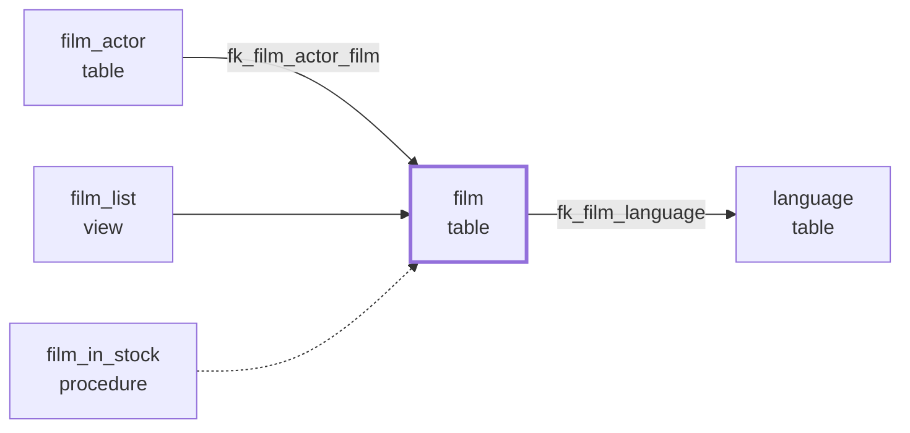

# E12 Database documentation

Generate a document of a database: tables, columns, keys, indexes, views, routines, triggers and events with their comments. Picked up from P-02.

## US-1201 Documentation as Markdown

**Status:** Done (accepted 2026-11-03)

As a developer, I want to generate a document of a database, so that I can keep it in a repository or Obsidian and share it.

**Acceptance criteria**

- [x] Context menu *Generate Documentation...* on a user database: choose the file (default `<database>.md`) and what to include.
- [x] Per table: comment, engine, columns (name, type, nullable, default, key, comment), primary key, foreign keys (with the referenced table), indexes, check constraints, triggers.
- [x] Views (columns and comment), procedures and functions (parameters, return type, comment), events (schedule, status).
- [x] A table of contents with links; objects sorted by name; the generation time and server version at the top.
- [x] Runs in the background with progress and Cancel, like Script Database (US-0603).
- [x] Added after the first test (Herbert, 2026-11-03): per table, view, procedure and function its dependencies, *Used by* and *Uses* as in US-1303, as text with links, and optionally a small diagram per object (not one large ERD).

**Tasks**

- [x] T-1201-01 `DatabaseDocumenter` (reads a `DatabaseDocument`, independent of the format, so US-1202 reuses it) + tests
- [x] T-1201-02 `MarkdownDocumentWriter` with table of contents and anchors + tests
- [x] T-1201-03 Dialog, command on a user database, wait dialog with progress and Cancel, open the file afterwards
- [x] T-1201-04 Dependencies per object (list with links, Mermaid diagram) + tests

**Implementation notes**

- *Generate Documentation...* is below *Script Database...* on a user database (not on system databases), enabled when connected. The dialog chooses the parts: tables (with keys, indexes, check constraints and triggers), views, procedures and functions, events; at least one. Then the save dialog, default `<database>.md`.
- Reading and writing run in the background behind the Visual Studio wait dialog with progress (*Tables: film (3 of 40)*) and Cancel; a cancelled or failed run leaves no file. Afterwards a message asks to open the file in Visual Studio.
- The content is read once into a `DatabaseDocument`; the Markdown writer only formats it. US-1202 adds a PDF writer on the same model.
- Document layout:
  - `# Database <name>`, then the connection and server version, the character set and collation, the generation time;
  - *Contents*: per part a link with the count, and a link per object;
  - per table: comment, engine and collation, a column table (Column, Type, Null, Default, Key = PK/FK/extra, Comment), the primary key, unique keys, foreign keys (columns, referenced table and columns, on update, on delete), indexes (columns, unique, type, invisible), check constraints, triggers (timing, event);
  - per view: comment and columns; per procedure or function: comment, return type, deterministic, data access, security, parameters (with mode for procedures);
  - events in one table: schedule, status, on completion, comment.
- The text of the document is English, like the scripts of Script Database. Line breaks in comments become ` `, a `|` in a cell is escaped; underscores are not escaped, so names stay readable in the file.
- Links use the heading anchors as GitHub and the Visual Studio Markdown preview make them (lower case, spaces to `-`, punctuation removed, a repeated heading gets `-1`). Obsidian resolves links to headings by their text; for names of lower case letters, digits and `_` that is the same. Names with capitals or spaces may not jump in Obsidian; check in the test.
- Check constraints are only read on servers that have them (MySQL 8.0.16+, MariaDB 10.2+).
- Dependencies: the dialog has *Dependencies per table, view and routine* and, below it, *With a diagram per object*, both on by default. The dependency catalog of US-1303 is read once for the whole database; each documented table, view, procedure and function gets a block **Dependencies** below its own content:
  - *Used by* and *Uses* as lists: the object (a link when it is in the document, with the database name when it is in another database), its kind and the reason: *foreign key fk_...*, *trigger on the table*, *text match*;
  - *None found.* when there are none;
  - with diagrams, a Mermaid `flowchart LR`: what uses the object on the left, the object in the middle (thick border), what it uses on the right. Foreign keys carry their name, text matches are dashed lines. GitHub and Obsidian draw Mermaid; whether the Markdown preview of Visual Studio draws it depends on its version (check in the test). Other viewers show the code block.
- When the dependencies cannot be read, the rest of the document is still written and the header says why. When sources could not be read with the account, the header says that text matches can be missing.

**Example of a dependency diagram** (table *film*)

**Manual test**

Use *sakila*.

1. Right-click *sakila*: *Generate Documentation...* is below *Script Database...*. Not on a system database; disabled when the server is not connected.
2. The dialog shows the four parts, all checked. Uncheck all: *Generate* is disabled.
3. Generate with all parts; the save dialog proposes `sakila.md`. The wait dialog shows the progress per object; the message asks to open the file.
4. Open it: the header shows the connection, server version, character set and time; *Contents* lists Tables (16), Views (7), Procedures (3), Functions (3), Events.
5. Table *film*: columns with types, NULL, defaults, PK/FK and comments; primary key; foreign keys to *language* with on update/on delete; indexes; triggers *ins_film*, *upd_film*, *del_film*.
6. Procedure *film_in_stock*: parameters with IN/OUT; function *inventory_in_stock*: return type.
7. Click links in *Contents* in the Visual Studio Markdown preview and on GitHub (or another viewer): they jump to the object.
8. Open the file in Obsidian: the tables render and the links of names such as *film_actor* jump.
9. Generate again with only *Views*: only the Views part.
10. Start on a large database and press Cancel: no file is left.
11. Theme (Dark, Light, Blue): the dialog is readable.
12. Dependencies: in the new file, table *film* has **Dependencies** with *Used by* (*film_actor*, *film_category*, *inventory* with their foreign keys, the views, the triggers, routines as text match) and *Uses* (*language*). The links jump to those objects.
13. The diagram below it: in Obsidian and on GitHub *film* in the middle, users on the left, *language* on the right, text matches dashed. Check whether the Visual Studio Markdown preview draws it too.
14. Uncheck *With a diagram per object*: lists, no diagrams. Uncheck *Dependencies*: the diagram option is disabled and no **Dependencies** blocks appear.
15. A table without dependencies: *None found.*

## US-1202 Documentation as PDF

**Status:** Ready for test

As a developer, I want the documentation of a database as a PDF, so that I can print it or send it to people who do not use Markdown.

**Acceptance criteria**

- [x] The same content as US-1201 as a PDF file, with page numbers and the table of contents.
- [x] Library: MigraDoc with PDFsharp, MIT license (D-20). Version 6.2.4, because 6.5 needs an AGPL or commercial license (D-22). Syncfusion was not needed.
- [x] Added at the acceptance of US-1201 (Herbert, 2026-11-03): the dependency diagram per object in the PDF too, drawn by the extension in the style of Mermaid, without a browser or an online service.

**Tasks**

- [x] T-1202-01 `PdfDocumentWriter` on the `DatabaseDocument` of US-1201: styles, header and footer with page numbers, contents with page numbers and links, outline, tables + tests
- [x] T-1202-02 `DependencyDiagram`: the Mermaid-style diagram drawn with PDFsharp + tests
- [x] T-1202-03 Format choice in the dialog (Markdown or PDF), save dialog per format, open the PDF in the PDF viewer of Windows

**Implementation notes**

- The dialog *Generate Documentation* starts with *Format*: *Markdown (.md)* or *PDF (.pdf)*. The choice is kept for the rest of the Visual Studio session. The save dialog proposes `<database>.md` or `<database>.pdf`. Afterwards the message asks to open the file: Markdown opens in Visual Studio, a PDF in the default PDF viewer of Windows.
- Same `DatabaseDocument`, same texts and parts as the Markdown file; the PDF writer only formats.
- Layout (A4, margins 2 cm, Segoe UI 9 pt):
  - page 1: title, connection and server version, character set and collation, generation time, notes about the dependencies, then *Contents* with a dotted line to the page number; every line is a link;
  - each part (Tables, Views, Procedures, Functions, Events) starts on a new page; objects follow each other on the page;
  - tables have a lilac header row that repeats when a table runs over a page; line breaks in comments stay line breaks;
  - a word wider than its column is split over lines, preferably after `_`, `,`, `.`, `(` or `-` (`CURRENT_` / `TIMESTAMP`); MigraDoc itself only wraps at spaces, so such a word ran into the next column (found in the first test, 2026-11-03);
  - header *Database <name>* on every page, footer *Page x of y*;
  - the PDF outline (bookmarks pane of the viewer) lists the parts and the objects.
- Dependencies: the same lists as in Markdown, with links to the objects in the document. The diagram has the look of the Mermaid default theme: rounded lilac boxes with name and kind, users on the left, the object in the middle with a thick border, used objects on the right, curved arrows, the foreign key name on a grey label, dashed lines for text matches. Labels are drawn on top of the lines. A wide or tall diagram is scaled down to fit the page, never enlarged.
- The diagram is drawn with PDFsharp into a one-page PDF and placed as an image, so it stays vector graphics (sharp when zoomed and printed).
- Fonts: Segoe UI from the Windows font folder, Arial when Segoe UI is missing; the fonts are embedded (subset) in the PDF.
- PDFsharp 6.2.4 brings `System.Security.Cryptography.Pkcs` 8.0.1 with known vulnerabilities; Core references 8.0.2 directly.

**Manual test**

Use *sakila*.

1. Right-click *sakila* > *Generate Documentation...*: the dialog starts with *Format*, Markdown selected. Choose *PDF*; the save dialog proposes `sakila.pdf` with the PDF filter.
2. Generate with all parts. The wait dialog shows the progress; the message asks to open the file; *Yes* opens it in the PDF viewer.
3. Page 1: title, server, character set, generation time and *Contents* with page numbers. Click a line: it jumps to that page.
4. Every page has the header *Database sakila* and *Page x of y* at the bottom. Tables, Views, Procedures, Functions and Events each start on a new page.
5. The bookmarks pane of the viewer shows the parts with their objects.
6. Table *film*: the same content as in Markdown (columns, primary key, foreign keys, indexes, triggers). A long column table continues on the next page with its header row.
7. Dependencies of *film*: *Used by* and *Uses*, links jump to the objects. The diagram: users on the left, *film* in the middle with a thick border, *language* on the right, foreign key names on the arrows, text matches dashed. Zoom in: the diagram stays sharp.
8. Generate again: the dialog remembers *PDF*. Uncheck *With a diagram per object*: lists without diagrams.
9. Choose *Markdown* again: the result is as in US-1201 and opens in Visual Studio.
10. Cancel on a large database: no file is left.
11. Print a page (or print to PDF): margins and page numbers are correct.
