# BT1-1549 Hertest stap voor stap

Tijdelijk, uitgebreid verslag van de hertest op 20-11-2026. Per stap staat wat we doen, wat we verwachten en wat we zien. Situatie 1 (buffer-item met piece) is volledig doorlopen. Situatie 2 (buffer-item met alleen raw material) loopt vast; dat punt en alle pogingen om verder te komen staan uitgeschreven.

## Wat de fix moet doen

`Conveyor.SearchAndMoveMaterial` stuurt bij een SearchAndMove het profieltype van het buffer-item mee naar de PLC (`CommandData((short)item.DetermineCommonProfileType(), 18)`). Bij de klant kwam voor raw material zonder piece `ProfileType.None` (0) aan. Na de fix moet ook voor raw material het juiste type aankomen, hier B = 4.

Waar we het controleren: in de PLC, `MachineObjectsArray.Conveyor[n].NewProduct[1].Info`. Die structuur krijgt de commandodata zodra de PLC het commando accepteert (`fLength`, `fWeightPerMeter`, `nPieceID`, `eProfileType`). ProfileType: None = 0, I = 1, L = 2, U = 3, B = 4.

## Omgeving

| Onderdeel | Waarde |
|---|---|
| VACAM | 4.11.37-alpha.14721 (machineversie), geïnstalleerd in `C:\Temp\Vacam\4.11.37-alpha` |
| Backup | 20230087 VSB1500_6_VP, backup 18-7-2024 (`20230087_VSB1500-VP2500_240718_132259`) |
| Simulatie | VASIM rc via VACAM Launcher RC, TwinCAT kernel mode, SQL-instance `CAM2022` |
| Uitlezen PLC | ADS op poort 851, watcher die elke 200 ms `Conveyor[0..6].NewProduct[1].Info` leest |
| VACAM-log | `Log 2026-11-20 09-26-32.log` |

### Vooraf: status 108 opgelost

Sinds 18-11 startte VACAM niet meer: "PLC did not reach active state within 30 seconds. Current state: 108" (WaitForConfigOk). Oorzaak gevonden op 20-11:

- Op 18-11 om 14:58:46 schreef VACAM bij het afsluiten 975 lege verwijzingen in de machineconfiguratie (`MC_20230087_VSB1500_6_VP`, tabel `ConfigurationLog`, NewValue leeg). Ingangen, assen en motor drives stonden daarna op leeg.
- Dat gebeurde omdat ik de PLC via ADS had gereset terwijl VACAM nog open stond.
- "Restore VACAM database" in de Launcher zet alleen `VACAM_20230087` terug, niet de MC-database. Daarom hielp dat niet, en ook een herstart van TwinCAT en van de pc niet.
- Opgelost door in de Launcher "Delete existing databases" aan te zetten. Alle databases zijn om 09:25 opnieuw aangemaakt uit de backup. Daarna kwam de PLC wel op Active (5).

## Uitgangssituatie (09:30)

| Item | Buffer | Inhoud | Positie | Search |
|---|---|---|---|---|
| 26532 | 13 (In Conveyor, transport 322) | piece 132691, B200*10, 6000 mm | X 26035 (grid: -2085) | Yes |
| 26533 | 10 (In Batches) | piece 132690, B200*10, 6000 mm | X 800 | No |

- PLC `Main.eState` = 5 (Active). `Conveyor[2]` heet "Conveyor3". `NewProduct[1].Info` is leeg (eProfileType 0).
- Buffers blauw (buffer manager nog niet actief). Geen stopflag, alleen de waarschuwing "Painting booth - The paint barrel in paint system 1 is almost empty".
- Herbert heeft de machine in VASIM gereset.

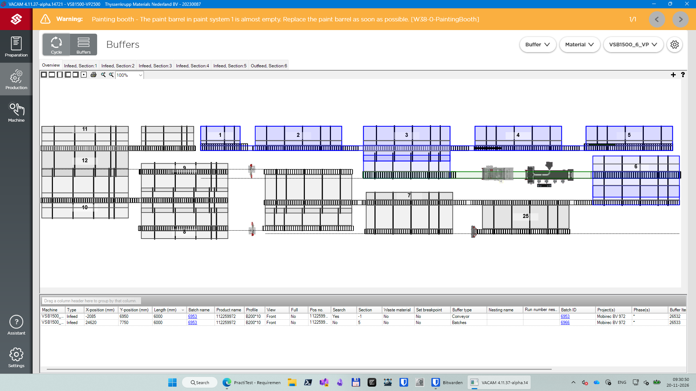

## Situatie 1: buffer-item met piece

| Stap | Tijd | Actie | Verwachting | Waarneming |
|---|---|---|---|---|
| 1.1 | 09:30 | VACAM: Production > Buffers openen | Item 26532 zichtbaar in de lijst | Regel 26532: B200*10, 6000 mm, Search Yes, Buffer type Conveyor. Conveyorbuffers 10, 11 en 12 links in de tekening zijn grijs |
| 1.2 | 09:31:13 | VASIM: Start | VACAM vraagt om een reference run | Melding "Reference run - Reference point unknown, start reference run?" (09:31:23) |
| 1.3 | 09:31:35 | VACAM: reference run met OK bevestigen | Reference run loopt, buffers worden groen | Venster "Reference points unknown": Shot blaster, Paint/Dry Zone en Infeed klaar, Extra Transport, Outfeed en Pre-heater bezig. Om 09:32:59 klaar, buffers 1 t/m 6 groen |
| 1.4 | 09:33 tot 09:37 | Wachten | VACAM verplaatst 26532 | Er gebeurt niets: geen SearchAndMove in het log, cyclusstatus "Rest" |
| 1.5 | 09:37:45 | VASIM: nogmaals Start (net als op 18-11) | VACAM stuurt SearchAndMove voor 26532 | 09:37:51 machine-event 1008, direct daarna `Buffer. Conveyor[2] SearchAndMove bufferItem: 26532 Position: [X:26035.00 Y:450.00 Z:0.00] Size: [X:6000 Y:200 Z:10]` |
| 1.6 | 09:37:53 | PLC-antwoord lezen | Commando geaccepteerd | Eerste poging: -4 "Part is stopped". Daarna elke seconde een nieuwe poging, steeds -96 "Machine stopflag detected". Stopflag in VACAM: "Painting booth - Thermal error mixer 1 [S38-128-PaintingBooth]" |
| 1.7 | 09:38:03 | PLC `Conveyor[2].NewProduct[1].Info` uitlezen | eProfileType = 4 | **fLength 6000, fWeightPerMeter 15,66, nPieceID 0, eProfileType 4, bUsed TRUE**. Ook `ProfileMotion.Profile.eProfileType` = 4 |

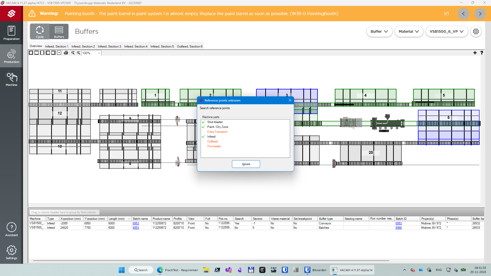

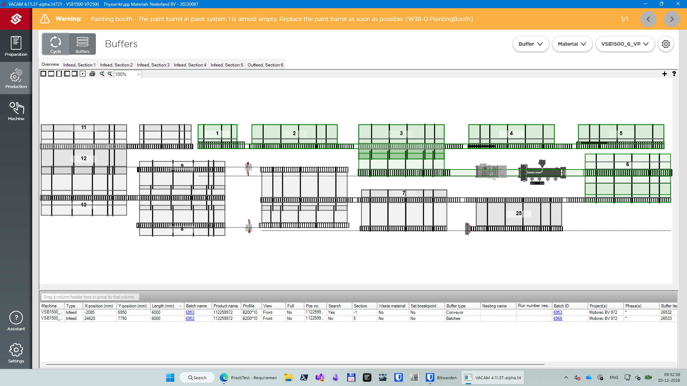

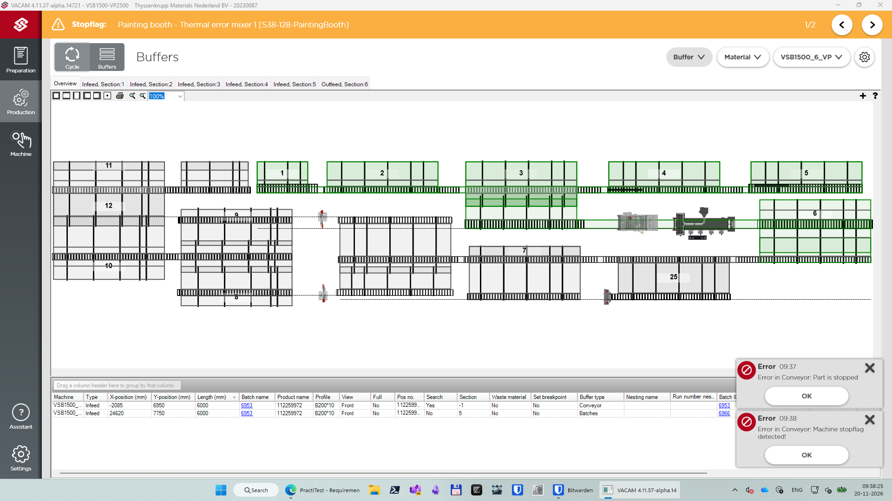

**Resultaat situatie 1: OK.** Voor een buffer-item met piece komt profieltype 4 (B) in de PLC aan, met de juiste lengte en het juiste gewicht per meter (B200*10 = 15,7 kg/m). Opvallend: `nPieceID` is 0, ook al heeft dit item een piece.

## De stopflag weghalen

De stopflag "Thermal error mixer 1" blokkeert alle conveyorcommando's (-96). Op 18-11 hielp het uitzetten van de Painting booth in de Cycle-tab niet. Dit is er vandaag gedaan:

| Stap | Tijd | Actie | Waarneming |
|---|---|---|---|
| S.1 | 09:39 | PLC uitlezen: `MachineObjectsArray.DigitalInput[256]` | sName ThermalErrorMixer1, bInvert TRUE, bActualRawValue TRUE, bActualValue TRUE (fout actief), bForce FALSE |
| S.2 | 09:39:26 | Via ADS: bForceValue = FALSE, daarna bForce = TRUE | bForce TRUE, bForceValue FALSE, bActualValue FALSE. De force gaat langs de inversie heen, dus FALSE betekent "geen fout" |
| S.3 | 09:39:47 | VASIM: Reset | Stopflag blijft in VACAM staan, nog steeds -96. VACAM krijgt geen machine-event 1008 |
| S.4 | 09:40:25 | VASIM: Reset all | Geen verandering, nog steeds -96 |
| S.5 | 09:41:31 | VASIM: Reset, 4 seconden ingedrukt | Geen verandering, geen event 1008 |
| S.6 | 09:42:04 | VASIM: Start | 09:42:09 event 1008. **Stopflag weg**, alleen de verfton-waarschuwing staat er nog. De SearchAndMove voor 26532 van 09:42:09 krijgt geen foutmelding: de PLC voert hem uit |

Conclusie: met de force op FALSE haalt alleen Start in VASIM de stopflag weg, Reset en Reset all niet.

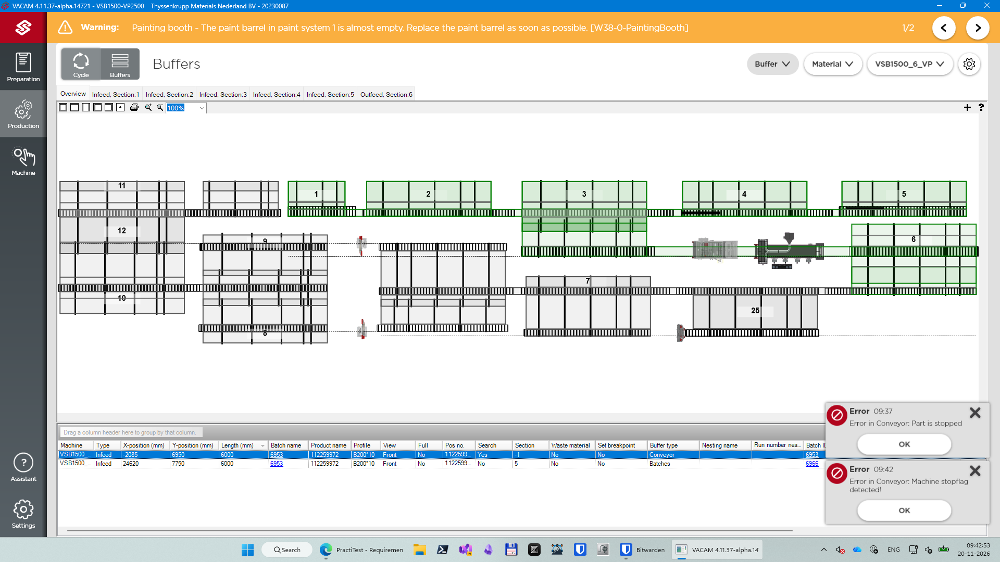

## Situatie 2: buffer-item met alleen raw material

### Poging A: raw material op buffer 11

Buffer 11 hoort bij een ander transport (262) dan buffer 13 (322), zodat item 26532 niet in de weg zit.

| Stap | Tijd | Actie | Waarneming |
|---|---|---|---|
| 2A.1 | 09:43 | VACAM: Material > Add | Venster "Add material", standaard buffer "In Line (Buffer ID= 17)", profiel B100*10 (type B, 7,83 kg/m) al ingevuld |
| 2A.2 | 09:44 | Buffer kiezen: "VSB1500_6_VP In Conveyor (Buffer ID= 11 6500.0 mm)" | X springt naar 32925 |
| 2A.3 | 09:44 | Length = 4000 | X springt naar 28925 (eind van de buffer). Geen Search-vinkje zichtbaar |
| 2A.4 | 09:45 | X = 26425 proberen (andere kant van de buffer) | VACAM zet X terug naar 28925; op deze buffer is maar één positie mogelijk |
| 2A.5 | 09:45:44 | Add | Log: "New bufferItem with id 26534 added to buffer with id 11". Database: PieceId leeg, ProfileId 219. **Geen SearchAndMove** |
| 2A.6 | 09:46 | Lijst bekijken | Regel 26534: X -37185, B100*10, 4000 mm, Search No, Buffer type Conveyor |
| 2A.7 | 09:46:52 | Regel 26534 selecteren, Material > Search aanzetten | Search wordt Yes. Nog steeds geen SearchAndMove: het item ligt al op zijn doelpositie, dus de buffer manager hoeft niets te verplaatsen |

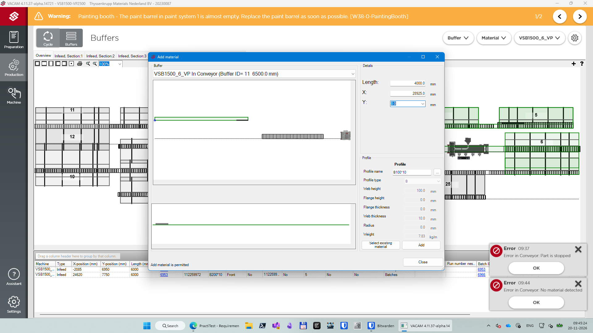

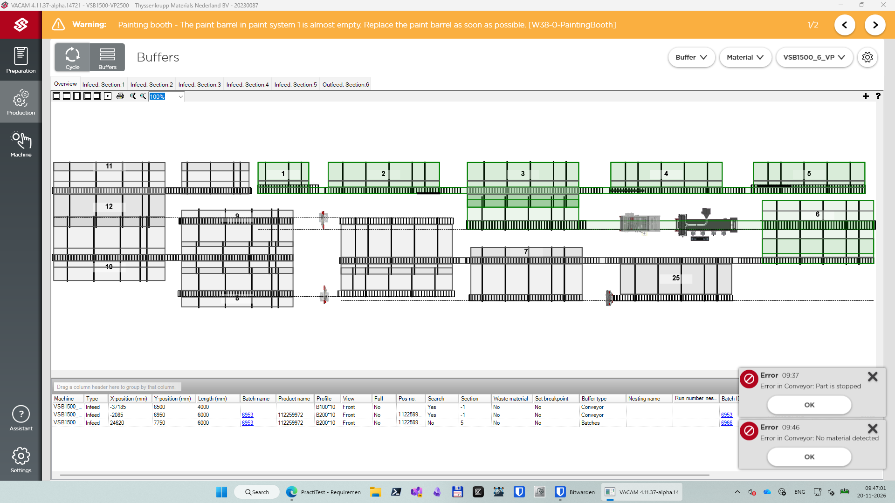

Tussendoor, situatie 1 loopt nog: om 09:44:09 eindigt de beweging van 26532 met -3603 "No material detected", want er ligt geen staaf in VASIM. Om 09:44:10 stuurt VACAM 26532 opnieuw. Dit herhaalt zich elke 2 minuten.

### Poging B: 26532 verwijderen zodat Conveyor[2] vrijkomt

| Stap | Tijd | Actie | Waarneming |
|---|---|---|---|
| 2B.1 | 09:47:37 | Regel 26532 selecteren, Material > Delete | Vraag "This buffer item is not at its final location. Are you sure you want to delete this buffer item?" |
| 2B.2 | 09:47:56 | Yes | Log: "Manual delete bufferitem: [26532] BufferId: [13]", daarna PLC-antwoord -7 "Cycle active, no manual functions permitted". Item blijft in de database staan |

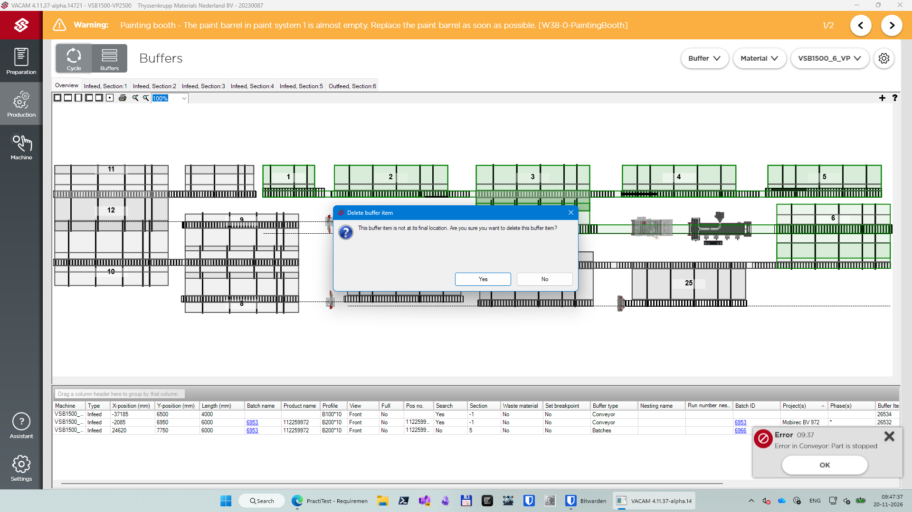

### Poging C: raw material op buffer 12, zoals op 18-11

Op 18-11 kreeg raw material op buffer 12 wel direct een SearchAndMove (toen geweigerd door de stopflag). Buffer 12 deelt transport 322 met buffer 13.

Omdat beide items type B zijn, is 4 alleen niet genoeg om ze uit elkaar te houden. De watcher kijkt daarom ook naar fLength (raw material 4000, piece 6000) en fWeightPerMeter (7,83 tegen 15,66).

| Stap | Tijd | Actie | Waarneming |
|---|---|---|---|
| 2C.1 | 09:50 | Material > Add, buffer "In Conveyor (Buffer ID= 12 6500.0 mm)", Length 4000 | X 0,0 en **Search aangevinkt**, net als op 18-11 |
| 2C.2 | 09:50:42 | Add | Log: "New bufferItem with id 26535 added to buffer with id 12". In de lijst: X -53385, B100*10, 4000 mm, Search Yes |
| 2C.3 | 09:50 tot 09:58 | Wachten op SearchAndMove voor 26535 | **Komt niet.** Elke 2 minuten (09:52:13, 09:54:14, 09:56:16, 09:58:17) eindigt 26532 met -3603. De PLC maakt dan `Conveyor[2].NewProduct[1].Info` leeg (L 0, Type 0) en 1 seconde later stuurt VACAM weer 26532 (L 6000, W 15,66, Type 4). 26535 komt nooit aan de beurt |
| 2C.4 | 09:58 | Tekening bekijken | Rode, gespiegelde tekst bij buffer 13: "Reserving buffer 13 for buffer 12 transfer". Buffer 12 wacht op een reservering van buffer 13 |

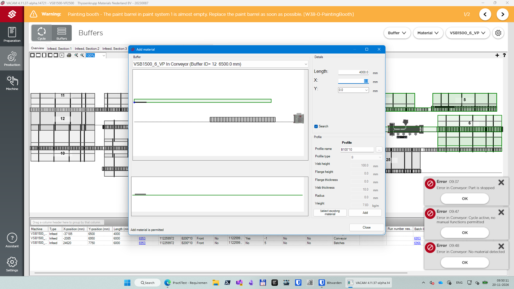

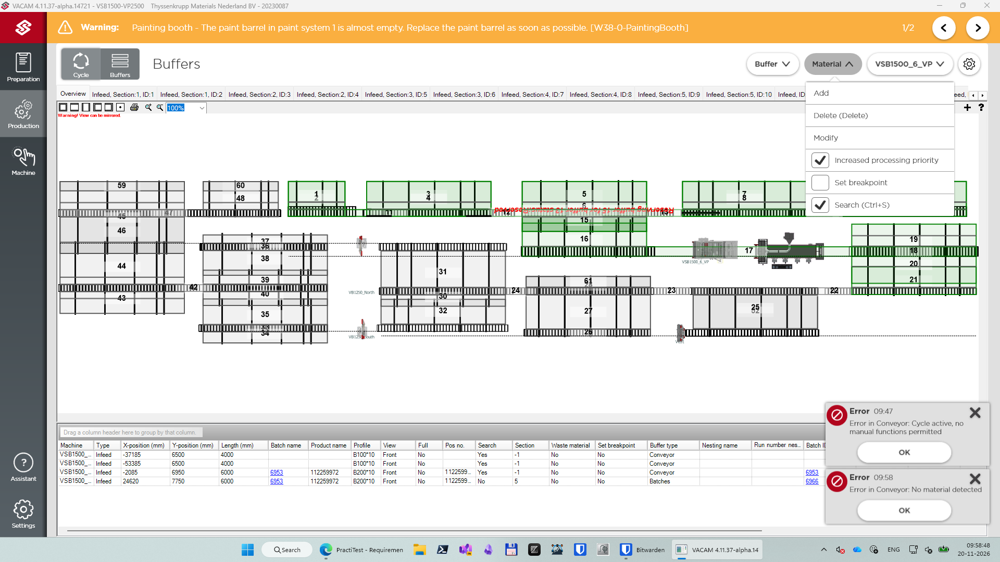

### Poging D: 26532 verwijderen in de seconde tussen twee pogingen

| Stap | Tijd | Actie | Waarneming |
|---|---|---|---|
| 2D.1 | 09:59:15 | 26532 selecteren, Material > Delete, vraag open laten staan | Script wacht op de volgende -3603 in het log |
| 2D.2 | 10:00:18.37 | Yes, 0,24 s na de -3603 van 10:00:18.13 | Log: "Manual delete bufferitem: [26532]", PLC-antwoord om 10:00:18.83: -7 "Cycle active, no manual functions permitted". Om 10:00:19 stuurt VACAM 26532 opnieuw |

De -7 komt dus niet van de lopende conveyorbeweging maar van de automaatcyclus die met Start in VASIM is gestart.

## Waar we vastlopen

Situatie 2 komt niet bij het punt waar de PLC een SearchAndMove voor raw material accepteert. Er zit een kringloop in:

1. Item 26532 (piece) bezet Conveyor[2]. Zijn beweging slaagt nooit, omdat er in VASIM geen staaf ligt (-3603), en VACAM probeert hem elke 2 minuten opnieuw.
2. Raw material op buffer 12 wacht op een reservering van buffer 13 en krijgt geen SearchAndMove.
3. Raw material op buffer 11 krijgt geen SearchAndMove, omdat het item daar direct op zijn doelpositie ligt.
4. 26532 verwijderen weigert de PLC tijdens de automaatcyclus (-7). Na Stop in VASIM weigert de PLC het door de stopflag "Stop button pressed" (-96, gezien op 18-11). Die stopflag gaat alleen weg met Start, en Start zet de cyclus weer aan.

Item 26532 rechtstreeks uit de database halen (zoals op 18-11) helpt niet: de buffer manager van VACAM houdt het item in het geheugen en blijft het sturen.

## Mogelijke vervolgstappen

1. **Staaf in VASIM leggen op de plek van 26532**, zodat die beweging slaagt en Conveyor[2] vrijkomt. Er ligt nu één staaf in VASIM (IPE300, 3000 mm, X 110212, Y 1102), niet bij 26532. Hulp nodig: hoe reken je de positie van een conveyorbuffer-item om naar VASIM-coördinaten?
2. **26532 verwijderen terwijl VACAM nog niet in automaat staat**: na de reference run, maar vóór de tweede Start (stap 1.4 liet zien dat er dan nog geen beweging loopt). Daarna alleen het raw material-item op buffer 12 zetten en dan pas Start.
3. **Database zonder 26532 starten**: 26532 vóór de VACAM-start uit `VACAM_20230087` halen, zodat de buffer manager het nooit kent.
4. **Unit test** voor `DetermineCommonProfileType` met een buffer-item zonder piece, zodat het raw material-geval los van de simulatie te bewijzen is.

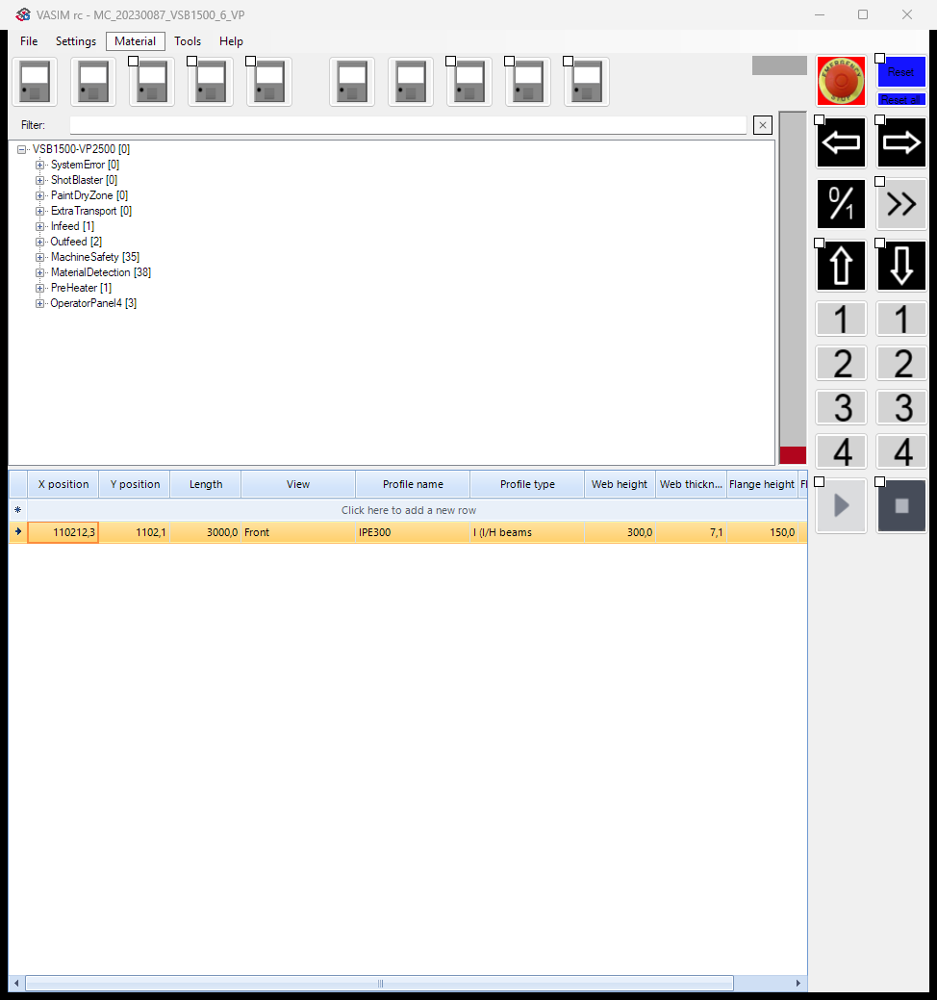

## Hertest 2: zonder VASIM, met Buffer simulation enabled (11:30 tot 11:50)

Vincent gaf aan dat VASIM deze stopflags ten onrechte zet en dat we met de simulatiemode van VACAM moeten testen.

| Stap | Tijd | Actie | Wat we zien |
|---|---|---|---|
| H.1 | 11:32 | VACAM en VASIM netjes afgesloten (Shutdown: Yes) | Beide processen weg. |
| H.2 | 11:34 | Launcher: Machine version, TwinCAT "Run without TwinCAT", Start; melding "Incorrect version" met OK gesloten | VACAM start, geen VASIM, TwinCAT blijft in Config. In `VACAM.exe.ini` staat `AdsPort=-1`: er is geen PLC. |
| H.3 | 11:36 | Production > Buffers > menu Buffer | Het menu toont "Refresh" en "Buffer simulation enabled" (uit). Met VASIM ontbreekt die optie. |
| H.4 | 11:40 | "Buffer simulation enabled" aangevinkt | Vinkje staat aan, nog geen beweging. |
| H.5 | 11:43:22 | Buffer > Refresh | 11:43:23 `Conveyor[2] SearchAndMove bufferItem: 26532`, sourcePos 3915, targetPos -11777,5 (dezelfde waarden als met VASIM). 11:43:39 klaar, daarna 26532 naar buffer 15 en 16 (11:44:02 Ready). 26533 schuift van buffer 10 naar 14. Geen stopflag, geen fout. |
| H.6 | 11:45 | Nog een Refresh | 26534 (buffer 11) en 26535 (buffer 12, raw material) blijven staan. |
| H.7 | 11:47 | VACAM netjes afgesloten, in `VACAM.exe.ini` `[DEBUG] BufferEnabledForLogging=11,12,13,14,15,16` gezet (kopie: `VACAM.exe.ini.bak-bt1549`), VACAM.exe direct gestart | Het vinkje wordt niet onthouden: opnieuw aangezet. |
| H.8 | 11:49:02 | Buffer > Refresh | `CheckBuffer for 11/12/13/14/15. AllowMove: True. Enabled: True; Transport Moving: False; Switched Off: False; Machine Part Stopped: False`. Er volgt geen beweging en geen reserveringsregel voor buffer 11 of 12. |

Wat dit laat zien:

- **Situatie 1 werkt in simulatie** van begin tot eind, zonder stopflags.
- **Situatie 2: VACAM vindt geen beweging voor de raw material-items.** De buffers mogen bewegen (AllowMove True), maar `ConveyorBufferManager.CheckForNextItemMovement` beweegt een item alleen als `GetPreferedXPosition` meer dan 0,1 van de huidige X afwijkt. Voor 26534 en 26535 is dat niet zo (of het doel is NaN), dus er komt geen SearchAndMove en `DetermineCommonProfileType` wordt voor deze items niet aangeroepen. De blokkade zit nu niet meer in een stopflag, maar in het ontbreken van een doel voor raw material zonder batch.
- **Het profiletype is in simulatie niet te zien.** Met Buffer simulation gaat het commando naar `ConveyorSimulation.StartMoving`, dat alleen de doelpositie (offset 4) gebruikt. Het profiletype (offset 18) wordt berekend, maar niet gelogd en niet naar een PLC gestuurd.

Vraag aan Vincent: hoe komt raw material bij de klant in beweging? Wordt het door een batch of een zoekopdracht van de operator gevraagd, en welke handeling hoort daarbij in VACAM?

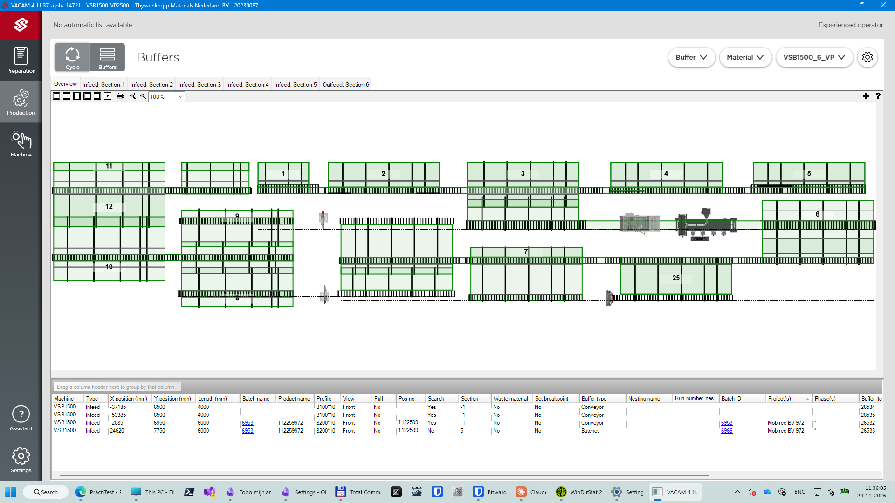
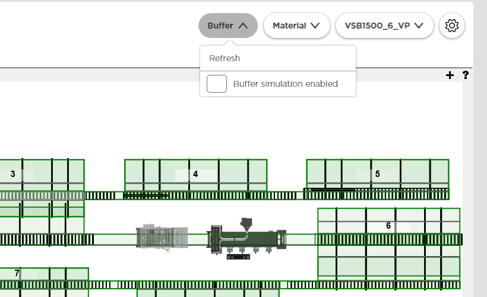
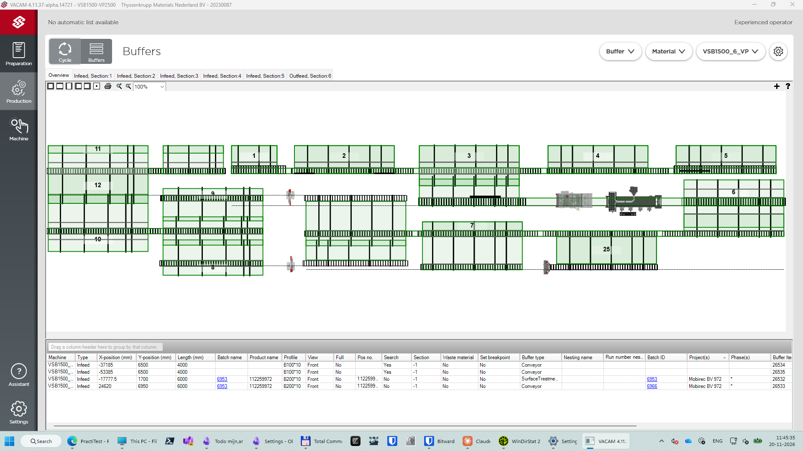

## Stand van de omgeving na de test

- VACAM draait zonder VASIM en zonder TwinCAT, met Buffer simulation enabled. VASIM is afgesloten.
- `VACAM.exe.ini` heeft een extra sectie `[DEBUG] BufferEnabledForLogging`. Het origineel staat in `VACAM.exe.ini.bak-bt1549`; de Launcher schrijft bij een volgende start zijn eigen ini.
- Database `VACAM_20230087`: 26532 (buffer 16), 26533 (buffer 14), 26534 (buffer 11, raw material), 26535 (buffer 12, raw material).
- Opruimen na afronding: databases 20230087, `C:\Temp\Vacam\4.11.37-alpha`, backupkopie in `C:\Temp\Customers\2023\20230087 VSB1500_6_VP Thyssenkrupp Materials Nederland BV`.
